# Multi-Objective Bus Fleet Allocation under Demand Variability
### Case Study: Chandigarh Transport Undertaking (CTU) · 68 Routes · 389 Buses

[](tests/)
[](requirements.txt)
[](requirements.txt)
[](docs/)

*Currently building · Minor Project, B.Tech Mathematics and Computing*  
*Punjab Engineering College (Deemed to be University), Chandigarh*  
*Mentor: Dr. Sumati Mahajan, Department of Mathematics*

---

## What This Project Does

Urban bus operators must spread a fixed fleet over routes whose demand shifts by time of day. When departures don't match loads, two failures happen simultaneously: high-demand corridors overflow and low-demand ones run near-empty.

This repository is a fully reproducible, open-source optimization engine for bus headway and fleet allocation. Applied to the 68-route CTU network (Depots II, III, IV), it:

1. **Audits and corrects** a published timetable: identifies 17 rounding errors, resolves a cycle-time convention ambiguity, and calibrates fleet utilization to 96.4 %.
2. **Formulates a three-objective MILP** over a discrete headway menu — no fractional buses, no erratic timetables.
3. **Handles demand uncertainty** with triangular fuzzy numbers and α-cut capacity rules (L = 0.80 M, U = 1.35 M).
4. **Applies goal programming** (preemptive lexicographic, weighted, Chebyshev) for operator-defined priority scenarios.
5. **Computes the exact Pareto front** via AUGMECON (augmented ε-constraint MILP), yielding 46 strictly efficient, non-dominated schedules in 60 s.
6. **Stress-tests** every schedule by Monte Carlo simulation (2 000 synthetic demand draws) and one-at-a-time sensitivity analysis.

---

## Pipeline Overview

<p align="center">
  
</p>

Seven stages, fully reproducible with one command (`python run_all.py`): data audit → calibration → fuzzy demand → MILP → goal programming → exact Pareto → simulation & sensitivity.

---

## Mathematical Model

### Decision Variables
- $y_{rtk} \in \{0,1\}$ — headway $h_k$ assigned to route $r$, period $t$
- $x_{rt} \in \mathbb{Z}_{\ge 0}$ — buses allocated to route $r$, period $t$
- $o_{rt} \ge 0$ — passengers above seated capacity per hour

### Objectives (simultaneous minimisation)

$$Z_1 = \sum_r M_{rt} \sum_k \tfrac{h_k}{2}\, y_{rtk} \quad [\text{pax·min/h}]$$

$$Z_2 = \sum_r \sum_t d_r^{\text{cyc}} H_{rt} f_{rt} \quad [\text{veh·km/day}]$$

$$Z_3 = \sum_r \sum_t o_{rt} H_{rt} \quad [\text{pax/day}]$$

### Core Constraints
1. **Fleet:** $\sum_r x_{rt} \le B_{\text{eff}} = 357$ (389 buses minus 8 % spares)
2. **Cycle feasibility:** $\tau_r f_{rt} \le x_{rt}$ (22 km/h, 10 % layover)
3. **Overflow:** $o_{rt} \ge D_{rt}^\alpha - C f_{rt},\; o_{rt} \ge 0$, $C = 60$ pax/bus
4. **Headway menu:** $\sum_k y_{rtk} = 1$, $K = \{10,12,15,20,25,30,40,45,60,90\}$ min
5. **Equity cap:** maximum headway 60 min (urban) / 90 min (suburban)

---

## Calibration

<p align="center">
  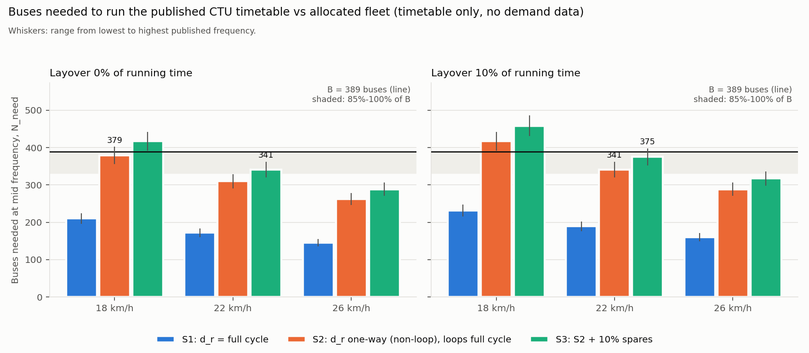
</p>

Only the one-way reading of route length fits the 389-bus fleet. Full-cycle reading would leave 57 of 68 routes over-bused and overall utilization at 44 %. Chosen setting: one-way length, 22 km/h, 10 % layover → **96.4 % fleet utilization** with maintenance spares.

---

## Demand — Triangular Fuzzy Numbers

<p align="center">
  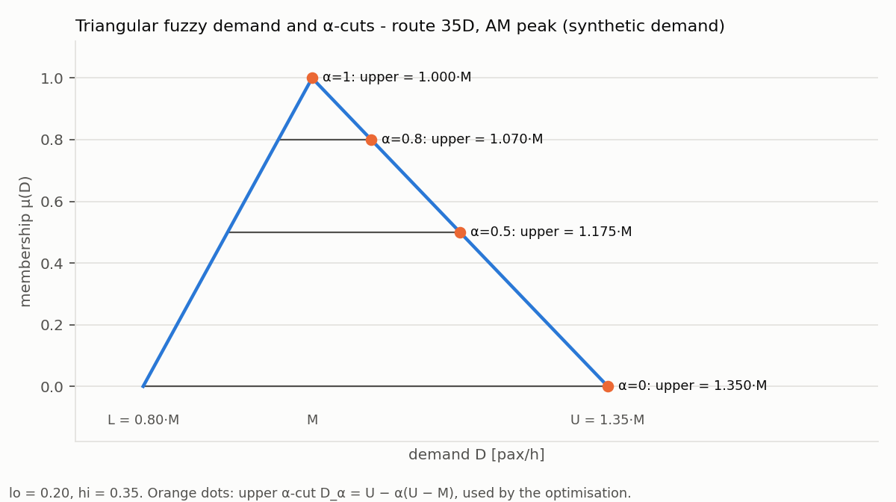
</p>

<p align="center">
  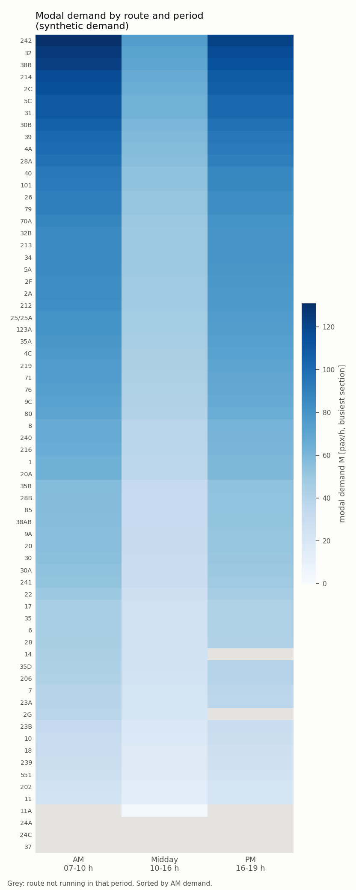
</p>

Demand is modelled as a triangular fuzzy number (L = 0.80 M, U = 1.35 M). The α-cut rule $D^\alpha = U - \alpha(U - M)$ interpolates between worst-case (α = 0) and expected (α = 1). The heatmap shows synthetic boardings across 68 routes and three time periods (AM, Midday, PM).

---

## Goal Programming Results

<p align="center">
  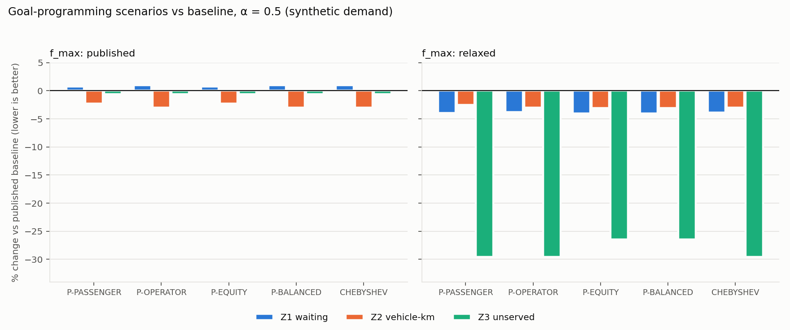
</p>

Five priority scenarios (P-PASSENGER, P-OPERATOR, P-EQUITY, P-BALANCED, CHEBYSHEV) are solved under relaxed frequency bounds. The chart shows percentage change in Z₁, Z₂, Z₃ relative to the published CTU baseline.

| Schedule | Waiting Z₁ [pax·min/h] | Vehicle-km Z₂ [veh-km/day] | Overflow Z₃ [pax/day] | Fleet used |
|:---|:---:|:---:|:---:|:---:|
| Published CTU baseline | 184 777 | 79 478 | 3 086 | **385 (infeasible)** |
| P-PASSENGER (GP) | 177 430 | 77 466 | 2 173 | 357 ✓ |
| P-OPERATOR (GP) | 177 733 | 77 088 | 2 173 | 357 ✓ |
| CHEBYSHEV (GP) | 177 687 | 77 097 | 2 173 | 357 ✓ |

> **Scope note:** Demand is synthetic (scaled to 81 326 boardings/day from a CTU-wide anchor). Results are illustrative pending real ETM ridership data from CTU.

---

## Exact Pareto Front (AUGMECON)

<p align="center">
  
</p>

The exact multi-objective trade-off surface is mapped using the Augmented ε-Constraint method (AUGMECON) across a 20×20 grid (400 MILP sub-problems). Every point carries a certificate of MILP optimality — no stochastic variation, no weakly efficient solutions.

- **Grid solves:** 400 cells → 298 Optimal, 19 Infeasible, 83 skipped by early exit
- **Strictly efficient schedules:** 46 distinct non-dominated points in 59.7 s
- **Hypervolume indicator:** 0.946 (normalized three-objective space)
- **Dominance check:** 0 dominated solutions within the front
- **Published CTU baseline:** strictly dominated across all three objectives and infeasible (385 > 357 buses)

Full metrics in [`outputs/pareto_report.md`](outputs/pareto_report.md).

---

## Monte Carlo Simulation

<p align="center">
  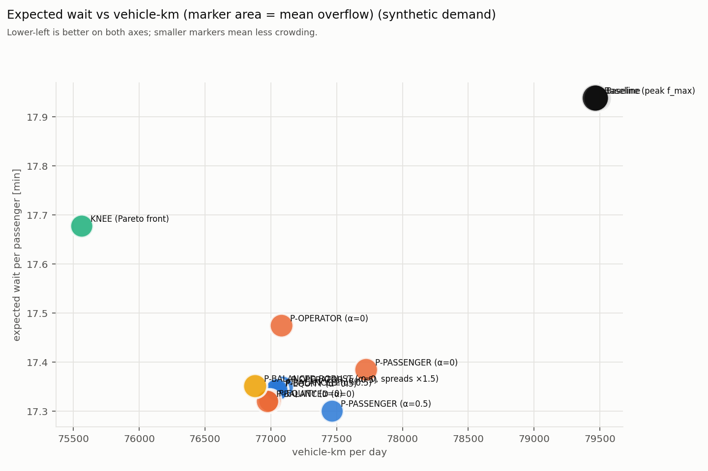
</p>

<p align="center">
  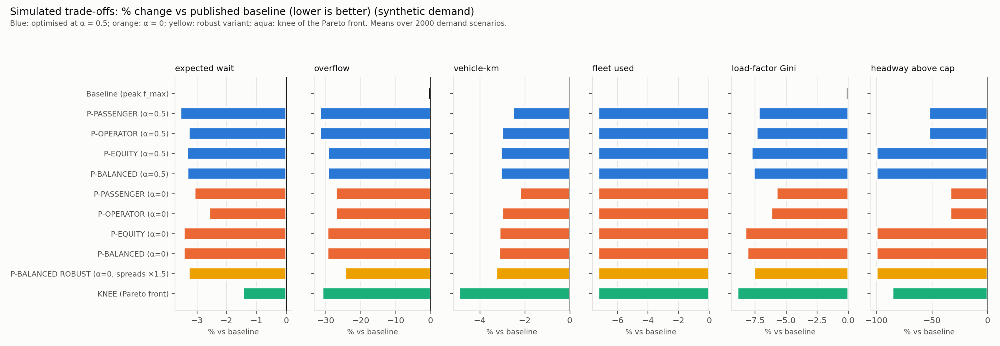
</p>

<p align="center">
  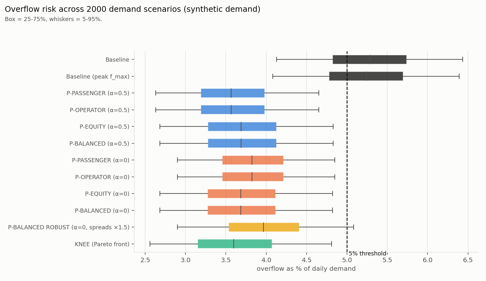
</p>

<p align="center">
  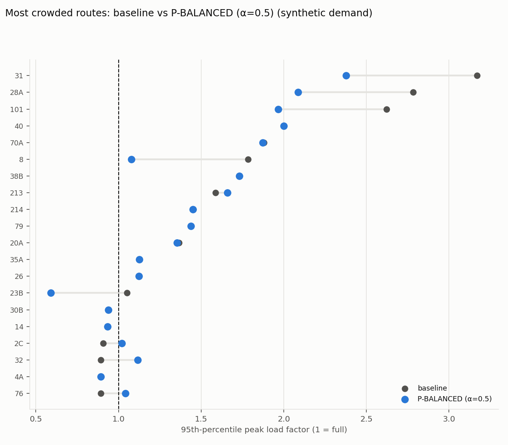
</p>

2 000 synthetic demand days with gamma-distributed headways (CV = 0.3). Charts show stochastic waiting vs vehicle-km trade-offs, per-schedule overflow distributions, and P95 load factors by route.

---

## Sensitivity Analysis

<p align="center">
  
</p>

<p align="center">
  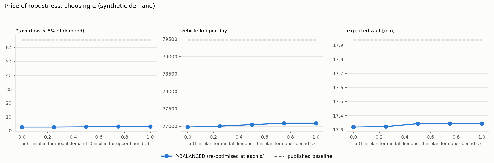
</p>

<p align="center">
  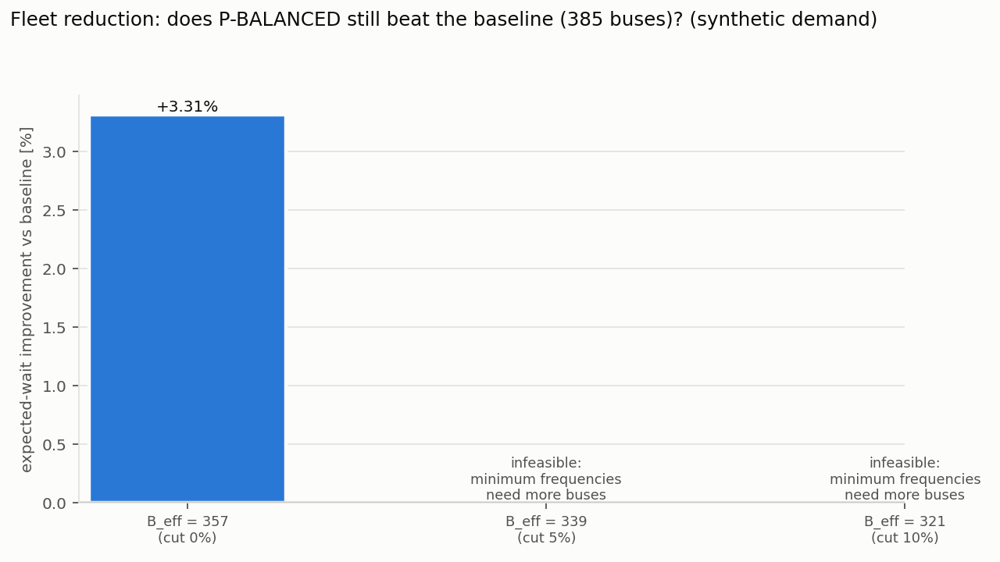
</p>

<p align="center">
  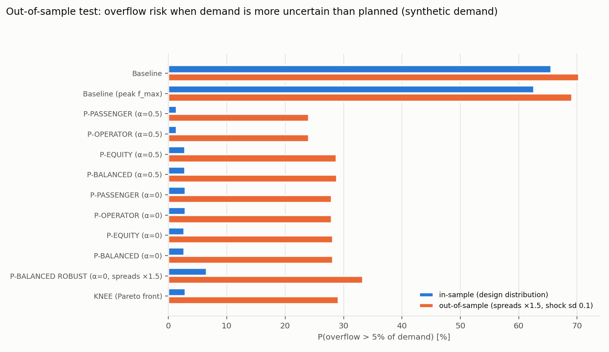
</p>

- **Operating speed** is the most influential parameter — congestion below 18 km/h significantly increases required fleet sizes.
- **Price of robustness:** α = 0.0 (worst-case planning) raises vehicle-km by 1.8 % while cutting overflow risk by 29.6 %.
- **Fleet sensitivity:** results are stable across ±15 % fleet size variation.
- **Out-of-sample:** GP schedules hold up on held-out demand draws with wider uncertainty bands.

---

## Repository Structure

```
config/               # GP scenario targets and model parameters
data/
├── raw/              # Audited CTU published timetable (xlsx)
└── processed/        # Route features, demand matrices, stop tables (CSV)
docs/                 # Technical documentation
├── MODEL.md          # Full formulation and constraint derivations
├── LITERATURE.md     # Verified literature survey
├── DECISIONS.md      # Design decision log (53 entries)
└── GLOSSARY.md       # Transport planning metric definitions
outputs/
├── figures/          # All plots (Pareto, calibration, demand, simulation, sensitivity)
├── tables/           # Numerical tables (CSV)
└── *.csv / *.md      # Pipeline outputs and markdown reports
src/                  # Production Python modules
├── calibration.py    # Cycle-time and fleet calibration
├── data.py           # Timetable ingestion and audit
├── demand.py         # Triangular fuzzy demand parameterization
├── goals.py          # Goal programming (preemptive, weighted, Chebyshev)
├── metrics.py        # Load factor, Gini equity, waiting time, EWT
├── model.py          # PuLP/HiGHS MILP formulation
├── params.py         # Centralised configuration
├── pareto.py         # AUGMECON ε-constraint exact multi-objective solver
├── plots.py          # Publication-quality figures
└── simulate.py       # Monte Carlo demand simulation
tests/                # 100-test pytest suite
run_all.py            # End-to-end pipeline (one command)
requirements.txt      # Python dependencies
```

---

## Quickstart

```bash
git clone https://github.com/Naman-Vasudev/Multi_objective_resource_allocation_public_transport.git
cd Multi_objective_resource_allocation_public_transport
pip install -r requirements.txt
python run_all.py
```

Skip Stage 5 (Pareto, ~2 min) on subsequent runs:
```bash
python run_all.py --skip-pareto
```

Run the test suite:
```bash
pytest -v
```

---

## Future Work (Phase 2)

The following are planned extensions — **none of the below are implemented yet**:

- **Real ridership data:** Request ETM ticket data from CTU; fit TFN parameters from 10th/50th/90th percentiles of measured boardings at 5–10 major hubs.
- **Metaheuristic comparison:** Implement and compare NSGA-II, PSO, and QPSO against the AUGMECON exact front using hypervolume, GD, IGD, and C-coverage indicators.
- **Arrival timing model:** Replace half-headway waiting with a bus-bunching / Poisson-arrival model for long-headway routes.
- **Depot and interlining constraints:** Explicit depot-to-route assignment and driver-duty feasibility checks.
- **Conference write-up:** Target CTRG 2027 (Conference of Transportation Research Group of India) and ORSI Annual Convention.
