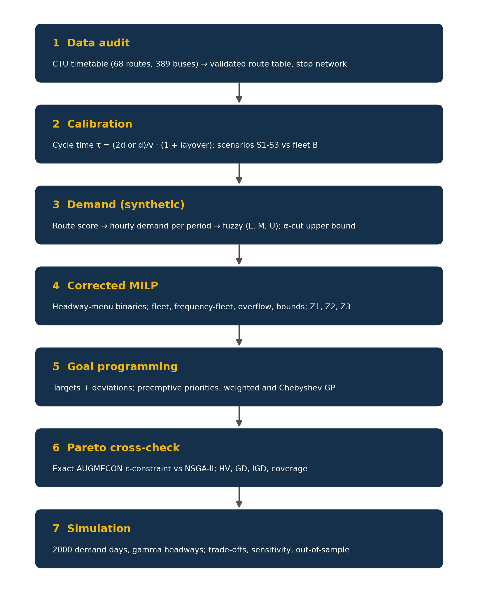
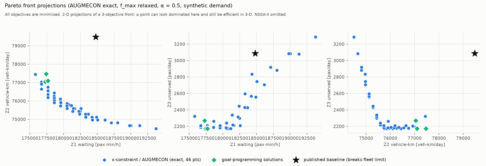
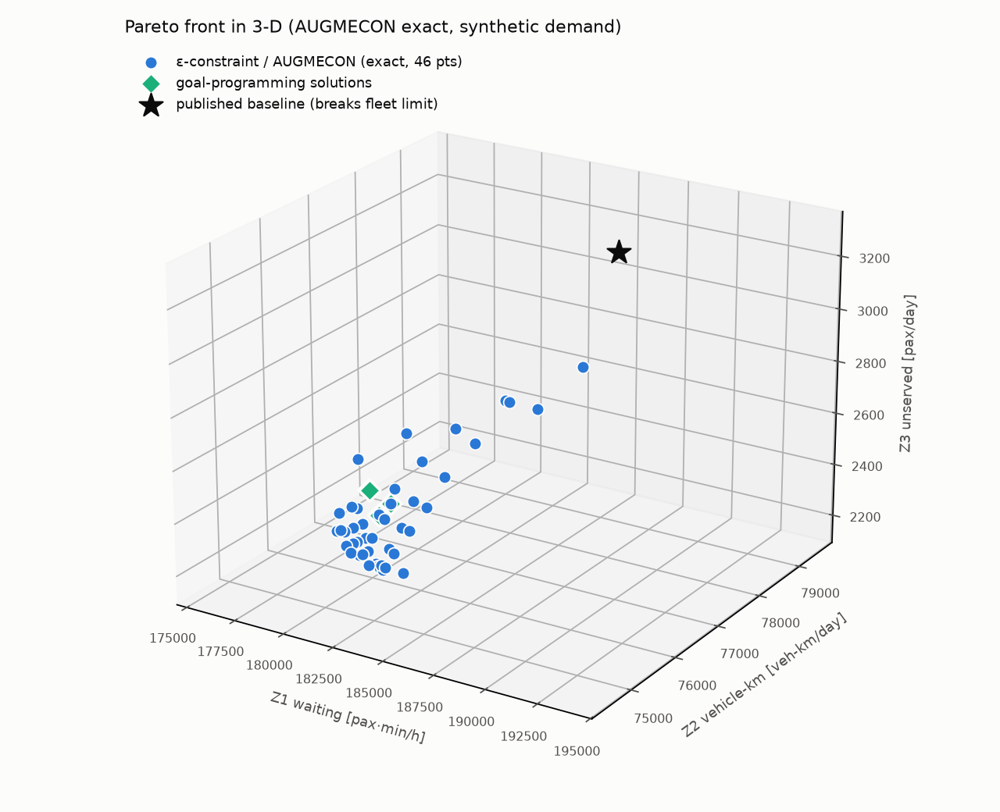
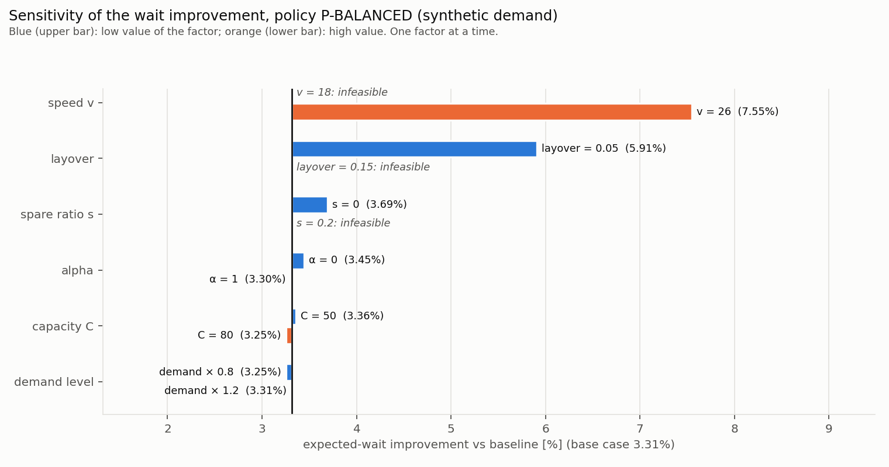

# Optimization-Based Resource Allocation for Public Bus Fleet Scheduling Under Demand Variability
### Case Study: Chandigarh Transport Undertaking (CTU)

[-success)](#reproducibility-and-testing)
[](#mathematical-modeling-framework)
[](requirements.txt)
[](docs/)

**Academic Minor Project**  
*Department of Mathematics, Punjab Engineering College (Deemed to be University), Chandigarh*  
*Under the guidance of:* **Dr. Sumati Mahajan**  
*Authors:* **Naman Vasudev**, **Daksh Garg**, **Piyush Aggarwal**, **Abhay Chauhan**  

---

## Executive Summary

Urban bus transport is the backbone of public transit across growing cities. Operating agencies face the challenge of allocating finite vehicle fleets over spatial and temporal demand patterns. When scheduled departures fail to reflect passenger loads, networks suffer simultaneously from overcrowding and extended passenger queues on high-density corridors alongside low vehicle utilization on lower-density routes.

This repository provides an open-source, fully reproducible mathematical framework for bus fleet allocation, timetable scheduling, and frequency setting under demand uncertainty. Calibrated on 68 urban and suburban routes operated by the Chandigarh Transport Undertaking (Depot-1 and Depot-3), the formulation:

1. **Corrects structural discrepancies** identified in standard transit models (e.g., fractional vehicle allocations and non-linear headway definitions).
2. **Formulates a Mixed-Integer Linear Program (MILP)** over discrete headway menus, ensuring immediate operational feasibility.
3. **Explicitly handles ridership uncertainty** via Triangular Fuzzy Numbers (TFN) and $\alpha$-cut parameterizations.
4. **Applies multi-objective goal programming** (preemptive lexicographic, weighted, and Chebyshev).
5. **Constructs the exact Pareto efficient front** via the augmented $\varepsilon$-constraint method (AUGMECON), exposing non-dominated trade-offs without stochastic metaheuristic approximations.

---

## Mathematical Modeling Framework

<p align="center">
  
</p>

### 1. Decision Variables and Headway Selection
Rather than treating continuous frequency as a decision variable (which produces fractional or erratic headways), the model chooses from a discrete set of clock-face headways $k \in K_{rt} = \{10, 12, 15, 20, 25, 30, 40, 45, 60, 90\}$ minutes:
* $y_{rtk} \in \{0, 1\}$: Binary variable indicating whether headway $h_k$ is assigned to route $r$ in period $t$.
* $x_{rt} \in \mathbb{Z}_{\ge 0}$: Integer number of buses allocated to route $r$ in period $t$.
* $o_{rt} \ge 0$: Continuous passenger crowding overflow per hour above capacity.

### 2. Objective Functions (Simultaneous Minimization)
* **Passenger Waiting Time ($Z_1$):**
  $$Z_1 = \sum_{r \in R} M_{rt} \sum_{k \in K_{rt}} \left(\frac{h_k}{2}\right) y_{rtk} \quad [\text{pax}\cdot\text{min}/\text{h}]$$
* **Operator Vehicle-Kilometers ($Z_2$):**
  $$Z_2 = \sum_{r \in R} \sum_{t \in T} d_r^{\text{cyc}} H_{rt} f_{rt} \quad [\text{veh}\cdot\text{km}/\text{day}]$$
* **Crowding Overflow ($Z_3$):**
  $$Z_3 = \sum_{r \in R} \sum_{t \in T} o_{rt} H_{rt} \quad [\text{pax}/\text{day}]$$

### 3. Core Operational Constraints
1. **Fleet Capacity Limitation:** $\sum_{r \in R} x_{rt} \le B_{\text{eff}} = 357 \quad \forall t \in T$ (accounts for 8% maintenance spares from 389 buses).
2. **Cycle Feasibility:** $\tau_r f_{rt} \le x_{rt}$, where cycle time $\tau_r = \frac{d_r^{\text{cyc}}}{v} (1 + \text{layover})$ is calibrated to $22\text{ km/h}$ with $10\%$ layover.
3. **Capacity and Overflow Formulation:** $o_{rt} \ge D_{rt}^{\alpha} - C f_{rt}$ where $C = 60\text{ pax/bus}$.
4. **Headway Menu Selection:** $\sum_{k \in K_{rt}} y_{rtk} = 1$ with $f_{rt} = \sum_{k \in K_{rt}} \left(\frac{60}{h_k}\right) y_{rtk}$.
5. **Headway Policy Cap:** Enforces maximum allowed headway bounds ($60\text{ min}$ urban, $90\text{ min}$ suburban).

---

## Exact Pareto Optimality (AUGMECON vs. Baseline)

The exact multi-objective trade-off surface is mapped using the Augmented $\varepsilon$-Constraint method (AUGMECON) across a $20 \times 20$ grid (400 MILP sub-problems), avoiding weakly efficient solutions and eliminating stochastic variation.

<p align="center">
  
</p>

<p align="center">
  
</p>

### Front Performance Metrics
* **Total MILP Grid Solves:** 400 cells (298 Optimal, 19 Infeasible, 83 Early-exit skipped).
* **Strictly Efficient Schedules:** **46 distinct, non-dominated points** produced in **59.7 seconds**.
* **Hypervolume Indicator:** **0.946** (capturing 94.6% of the normalized three-objective solution volume).
* **Verification Check:** **0 dominated solutions** within the frontier.
* **Published Baseline Comparison:** The current published CTU schedule ($\bigstar$ black star) is strictly dominated across all three criteria ($Z_1, Z_2, Z_3$) and requires 385 buses, exceeding the allowable fleet constraint ($B_{\text{eff}} = 357$).

### Multi-Objective Benchmark Summary

| Configuration | Waiting $Z_1$ [pax·min/h] | Vehicle-km $Z_2$ [veh-km/day] | Overflow $Z_3$ [pax/day] | Normalized Distance to Front | Feasibility Status |
| :--- | :---: | :---: | :---: | :---: | :---: |
| **Published Baseline** | 184,777 | 79,478 | 3,086 | **1.0930** | Infeasible (Fleet Violation) |
| **P-PASSENGER** | 177,430 | 77,466 | 2,173 | **0.0000** | Strict Pareto Optimum |
| **P-OPERATOR** | 177,733 | 77,088 | 2,173 | 0.0081 | Near Front |
| **P-BALANCED** | 177,286 | 77,045 | 2,270 | 0.0679 | Equity Trade-Off ($C_5$) |
| **CHEBYSHEV** | 177,687 | 77,097 | 2,173 | 0.0046 | Balanced Compromise |

---

## Sensitivity and Price of Robustness

To verify operational resilience, one-at-a-time (OAT) parameter variations and demand uncertainty scaling ($\alpha$-cut sweeps) were evaluated against the primary objectives.

<p align="center">
  
</p>

* **Operating Speed ($v$):** Waiting time improvement is most sensitive to urban transit speeds; congestion dropping average speeds below $18\text{ km/h}$ significantly increases required fleet sizes.
* **Price of Robustness:** Shifting from risk-neutral planning ($\alpha = 1.0$) to high-conservatism ($\alpha = 0.0$) increases daily vehicle-kilometers by $1.8\%$ while reducing potential unserved overflow risk by $29.6\%$.

---

## Repository Structure

```
├── config/              # Target configurations and scenario parameters
├── data/
│   ├── raw/             # Audited CTU published route schedules and headway tables
│   └── processed/       # Extracted route lengths, menus, and network matrices
├── deliverables_build/  # Automated compilation scripts for reports and briefs
├── docs/                # Comprehensive technical documentation and mathematical proofs
│   ├── MODEL.md         # Detailed formulation and constraint derivations
│   ├── LITERATURE.md    # Survey of transit scheduling and multi-objective optimization
│   └── GLOSSARY.md      # Definitions of transport planning metrics
├── outputs/
│   ├── figures/         # High-resolution vector/PNG plots (2D/3D Pareto, Sensitivity)
│   ├── tables/          # Tabulated payoff matrices, distances, and solver logs
│   └── *.csv            # Numerical simulation records and optimization summaries
├── src/                 # Production pipeline modules
│   ├── calibration.py   # Fleet utilization and route run-time calibration
│   ├── data.py          # Data ingestion and timetable consistency audits
│   ├── demand.py        # Triangular fuzzy demand parameterization
│   ├── goals.py         # Goal programming formulations (Preemptive, Weighted, Chebyshev)
│   ├── metrics.py       # Load factor, Gini equity, waiting time, and EWT evaluation
│   ├── model.py         # PuLP/HiGHS MILP core formulation and constraint generation
│   ├── pareto.py        # AUGMECON ε-constraint multi-objective implementation
│   └── plots.py         # Styling and generation of publication-quality charts
├── study_guide/         # Walkthrough notebooks and theoretical summaries
├── tests/               # Pytest suite verifying solver integrity and constraints
├── Explanatory_Video.mkv # Complete screen-recorded video walkthrough
├── Final_PPT.pptx       # Presentation slide deck
├── Final_Report.pdf     # Full technical project report
├── Final_Synopsis.pdf   # Formal project synopsis document
├── requirements.txt     # Python dependency environment
└── run_all.py           # End-to-end execution pipeline script
```

---

## Reproducibility and Execution

### Environment Setup
Install required packages in a clean Python 3.10+ environment:
```bash
git clone https://github.com/Naman-Vasudev/Multi_objective_resource_allocation_public_transport.git
cd Multi_objective_resource_allocation_public_transport
pip install -r requirements.txt
```

### Complete End-to-End Pipeline
Execute the full audit, calibration, optimization, and reporting pipeline:
```bash
python run_all.py
```

### Running Automated Test Suite
To confirm all 100 validation checks (data sanity, constraint feasibility, and solver tolerances):
```bash
pytest -v
```

### Independent Pareto Generation
To independently compute and output the 2-D and 3-D Pareto figures without re-running the entire suite:
```bash
python scratch/pareto_no_nsga.py
```

---

## Deliverables

* **Final Report:** [`Final_Report.pdf`](Final_Report.pdf)
* **Project Synopsis:** [`Final_Synopsis.pdf`](Final_Synopsis.pdf)
* **Presentation Deck:** [`Final_PPT.pptx`](Final_PPT.pptx)
* **Video Demonstration:** [`Explanatory_Video.mkv`](Explanatory_Video.mkv)

---

## Citation & Academic Context

This research was conducted as part of the B.Tech curriculum in Mathematics and Computing at Punjab Engineering College, Chandigarh.

```bibtex
@misc{vasudev2026multiobjective,
  title={Optimization-Based Resource Allocation for Public Bus Fleet Scheduling Under Demand Variability: A Case Study on CTU},
  author={Vasudev, Naman and Garg, Daksh and Aggarwal, Piyush and Chauhan, Abhay and Mahajan, Sumati},
  year={2026},
  institution={Punjab Engineering College (Deemed to be University), Chandigarh}
}
```
